# Vak-Siddhi Competition Demo

Prepared 2026-10-14 for the 2026-10-15 presentation. Academic acoustic screening prototype; prerecorded audio only. Use the frozen single-second model. No live-call, semantic analysis, fusion, identity verification, or authenticity guarantee is implemented.

## Before Going On Stage

Start the backend and frontend using COMPETITION_READINESS.md. Open `/demo`, run one comparison to warm the checkpoint, test both audio clips and projector audio, then refresh the page so the demonstration begins with no computed predictions. Close unrelated tabs and mute notifications. Keep the CLI commands below available. Do not reinstall, download datasets, change the threshold, or train during the competition.

All six WAV files are bundled locally. After dependency installation, the model and web app need no internet. Keep the local backend running; a disconnected backend produces an explicit error, never a canned prediction. Refresh resets the comparison; history remains in this browser. Browser privacy settings can disable storage. Clear history before the presentation if desired.

## 90-Second Walkthrough

1. **0-15 seconds:** "Vak-Siddhi screens a prerecorded voice for acoustic spoof signals. It does not verify a speaker or declare a caller safe." Point to the three-stage flow and the two visibly separate dataset labels.
2. **15-30 seconds:** Play a short portion of `bonafide_1.wav` and `spoof_1.wav`. "Both recordings have dataset-declared labels. The predictions below are initially empty; we compute them now."
3. **30-50 seconds:** Click **Run comparison**. "The unchanged Python pipeline decodes each WAV, mixes to mono, resamples to 16 kHz, crops or pads the first second, and builds an 80-bin log-Mel representation. A MobileNetV2 student produces two model scores."
4. **50-65 seconds:** Point to results. The local verified baseline gives spoof scores `0.0033067096956074238` and `0.1198771521449089`; fixed operating threshold `0.05530281`. "The spoof clip raises an alert even though its bonafide score is numerically larger. We use the validation-selected operating point, not an argmax or a 0.5 cutoff. The lower result is inconclusive."
5. **65-80 seconds:** Open **Model information**. "A saved balanced 2,000-example test sample reports 75.3% spoof recall and a 1.0% bonafide false-alert rate. Those are historical sampled results, not a new full-split evaluation. Unseen spoof systems remain difficult. Our six-file local check verifies the demonstration, not generalization."
6. **80-90 seconds:** Open **Analysis history** and show both actual saved results. "Everything runs locally, with no paid API. Multi-segment detection and broader independent evaluation are future work; we preserved the stable first-second implementation."

## Architecture

```mermaid
flowchart LR
    A[Local WAV / stopped microphone recording] --> B[FastAPI upload validation]
    B --> C[Existing AcousticAnalyzer]
    C --> D[SoundFile decode and mono mix]
    D --> E[16 kHz resample]
    E --> F[First second crop / zero pad]
    F --> G[80 x 101 log-Mel FFT 400 hop 160]
    G --> H[MobileNetV2Student one-channel two-class head]
    H --> I[Softmax model scores]
    I --> J[Fixed spoof threshold 0.05530281]
    J --> K[Alert or inconclusive]
    K --> L[React results and metadata-only local history]
```



Checkpoint loading is reused across requests. The API serializes inference and removes temporary uploads. Browser preview decoding does not replace the uploaded WAV: the original uploaded bytes go to the existing analyzer. Browser recordings are converted to PCM16 WAV after stopping.

## Q&A Cheat Sheet

| Question | Credible Answer |
|---|---|
| What is novel? | The project demonstrates a lightweight acoustic student and an interpretable, local workflow. MobileNetV2, log-Mel features and knowledge distillation are established methods. We do not claim a new architecture or state-of-the-art research result. |
| Why MobileNetV2? | It offers a compact convolutional backbone for single-channel spectrogram classification. The repository contains the existing student checkpoint. We measured about 33 ms warm median end-to-end analyzer latency on this CPU; that is a local observation, not a hardware-independent promise. |
| How accurate is it? | The saved test extract reports 87.15% accuracy on a balanced sampled 2,000 recordings, 75.3% spoof recall, and 1.0% bonafide false alerts. We did not rerun those 2,000 examples because the data/scripts are not present. The six local examples all follow their declared labels; six examples do not validate generalization. |
| What are false positives and negatives? | In the saved test sample, 10/1,000 bonafide clips alerted and 247/1,000 spoofs were missed. Rows are true labels and columns are predicted labels: `[[990,10],[247,753]]`. A missed alert must never be interpreted as verified authenticity. |
| Why does a spoof have a higher bonafide score? | The operating point was selected on validation and carried into the saved test evaluation. An alert uses the spoof score compared with 0.05530281; scores are not calibrated probabilities of authenticity. |
| What about the impressive validation AUC? | The saved validation predictions are inconsistent with the saved scores/operating point. We explicitly disclose that problem and do not use it as evidence of validated operating performance. |
| Which spoof systems are difficult? | Existing diagnostics flag A17-A19 as weak generalization cases. We cannot assign attack systems to these six clips because their source protocol identifiers were not retained. |
| Is it detecting live calls or scams? | No. Acoustic-only, recorded audio, first second. No semantics, speaker identity, scam intent, live streaming or acoustic-semantic fusion. |
| Why not use every second? | More windows change recording-level false alerts and latency. We computed exploratory per-window outputs, but have no independent development split to validate max/mean/top-k aggregation or its operating point. It stays outside the API and competition demo. |
| How were demo ground-truth labels obtained? | The local downloader maps dataset index 0 to bonafide and 1 to spoof. Its cached dataset card agrees. We distinguish these declared labels from model predictions; original utterance IDs were not retained, so per-file provenance is incomplete. |
| What are the future priorities? | Restore immutable source IDs and attack metadata, evaluate at least 100 per class on independent development and held-out test data, measure channel/noise and unseen-attack performance, then validate aggregation and calibration before deployment. |
| Where does data go? | To the local FastAPI process, which deletes temporary uploads. History stores only metadata in this browser. No paid/cloud inference service. The localhost API has no public-deployment access controls. |

## Fallback Commands

From the repository root in PowerShell:

```powershell
.\.venv\Scripts\python.exe -m demo.run_audio .\test_audio\bonafide_1.wav
.\.venv\Scripts\python.exe -m demo.run_audio .\test_audio\spoof_1.wav
.\.venv\Scripts\python.exe -m demo.app
```

If the microphone is blocked, use the bundled WAV files. If the web app fails, present the unchanged CLI JSON or original GUI. If a sample ever produces an unexpected prediction, disclose it; do not rename the label, hide the result or adjust the threshold on stage.
